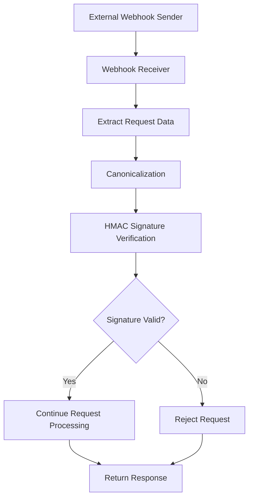

# WebhookGuard — System Architecture

## 1. Overview

WebhookGuard is a security-focused project designed to validate incoming webhook requests and help protect webhook processing from forged or tampered messages.

Webhooks allow one application to notify another application when an event occurs. Since webhook endpoints can receive requests over the internet, verifying the authenticity and integrity of incoming data is an important security measure.

WebhookGuard uses HMAC-related utilities, canonicalization, and validation logic to support secure webhook handling.

## 2. High-Level Architecture

The system can be understood through the following request flow:

The diagram represents the conceptual verification flow. The exact request-handling sequence should be checked against the implementation.

## 3. Main Components

### 3.1 Webhook Receiver

The receiver accepts incoming webhook requests and obtains the relevant request information, such as the payload, timestamp, event identifier, and signature.

It provides the entry point for validating webhook events before they are processed.

### 3.2 Canonicalization Utility

Canonicalization converts the relevant request fields into a consistent representation for signature generation and verification.

The sender and receiver must follow the same canonicalization rules. Differences in field ordering, encoding, separators, or payload bytes can cause signature verification to fail.

### 3.3 HMAC Utility

The HMAC utility supports generating and verifying message authentication codes using a shared secret.

The receiver independently computes the expected signature and compares it with the signature supplied by the sender.

A valid signature provides evidence that the signed data matches the data authenticated using the shared secret. It does not, by itself, guarantee that the request is fresh or prevent replay attacks.

### 3.4 Validation and Error Handling

The validation stage checks whether incoming request data satisfies the application's requirements.

Invalid signatures, malformed inputs, or failed validation should prevent the request from proceeding through the protected processing path.

Timestamp and event identifier validation should follow the project's implemented rules.

### 3.5 Automated Tests

Automated tests help verify the behavior of the security utilities and request-handling flow.

Important scenarios include:

- Valid webhook signatures
- Tampered payloads
- Invalid or forged signatures
- Replay-related validation
- Malformed inputs and boundary cases

The existing integration tests should be consulted for the precise scenarios currently covered.

## 4. Webhook Verification Flow

A typical verification process consists of these steps:

1. The sender prepares a webhook event.
2. The sender generates a signature using the shared secret and agreed signing format.
3. The receiver obtains the incoming payload and associated signature information.
4. The receiver constructs the canonical representation required by the signing protocol.
5. The receiver calculates the expected HMAC.
6. The supplied signature is verified against the expected signature.
7. The request proceeds only if the applicable validation checks succeed; otherwise, it is rejected.

The precise order and set of validation checks depend on the implementation.

## 5. Security Considerations

### Payload Integrity

The receiver should verify the signature against the exact payload representation required by the signing protocol. Parsing and reserializing JSON before verification can change the bytes being signed.

### Secret Management

- Keep webhook secrets out of source control.
- Use environment variables or an appropriate secret manager.
- Avoid logging secrets or sensitive authentication data.

### Replay Protection

A valid signature may be reused by an attacker if requests are not protected against replay. Timestamp validation, freshness windows, and event deduplication can help mitigate this risk when implemented correctly.

### Signature Comparison

Use a constant-time comparison mechanism where appropriate to avoid leaking information through timing differences.

### Input Validation

Validate timestamps, event identifiers, signature formats, and payload requirements according to the application's protocol.

## 6. Testing Strategy

Testing should cover both individual utilities and their integration.

| Test category | Purpose |
|---|---|
| Valid signature | Verify that legitimate requests pass |
| Payload tampering | Check that modified payloads fail verification |
| Forged signature | Ensure invalid signatures are rejected |
| Replay-related cases | Verify the implemented replay protections |
| Invalid inputs | Check how malformed values are handled |
| Integration tests | Validate the end-to-end request flow |

Run the repository's existing test suite using the commands documented in its README or development instructions.

## 7. Possible Future Improvements

Potential areas for further development include:

- Expanded edge-case and boundary testing
- More detailed security-related error handling
- Structured logging that avoids sensitive data
- Clearer documentation of canonicalization rules
- Additional replay-protection tests
- Continuous integration for automated test execution

These are potential improvements rather than claims about existing functionality.

## 8. Conclusion

WebhookGuard's architecture centers on validating incoming webhook data through canonicalization, HMAC-based signature verification, and appropriate request validation.

Separating these responsibilities into focused utilities makes the implementation easier to understand, test, maintain, and extend.

